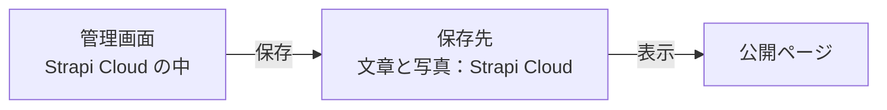
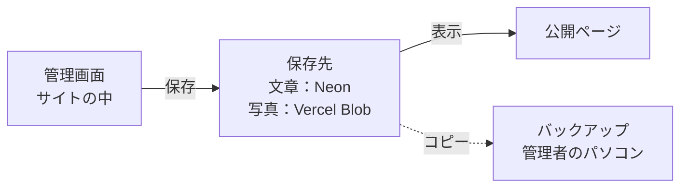

# 作品サイトの仕組み

2026年11月23日時点

## 資料の目的

作品サイトの文章と写真が消えた経緯と、再発を防ぐために作り直した今の仕組みを説明します。使い方は[別のページ](usage.md)にまとめています。

## 問題の説明

文章と写真を Strapi Cloud だけに預けていたため、無料プランの廃止ですべて消えました。

- **管理画面**：Strapi Cloud の中で動いていました。
- **保存先**：文章も写真も、Strapi Cloud だけでした。
- **バックアップ**：ありませんでした。
- **費用**：無料でした。

文章は残っていたページから取り戻せましたが、写真は見つかった6点しか戻せていません。

## 解決策の概要

管理画面をサイトの中に移し、文章と写真を標準的な形式で保存して、バックアップを取るようにしました。

- **管理画面**：外部のサービスではなく、サイトの中で動いています。
- **保存先**：文章は Neon、写真は Vercel Blob に保存しています。どちらも標準的な形式なので、ほかのサービスに比較的引っ越しやすくなっています。
- **バックアップ**：文章と写真のコピーを、管理者のパソコンにも定期的に保存しています。サービス側で消えても、ここから戻せます。
- **費用**：今のところ無料です。

## 使わなかった案

| 案                                   | 使わなかった理由                                                              |
| ------------------------------------ | ----------------------------------------------------------------------------- |
| microCMS、Sanity などの CMS サービス | サイトがそのサービス独自の API に依存し、乗り換えるときに作り直しが必要になる |
| Strapi を専用のサーバーで動かす      | 月々の費用と、サーバーの手入れがかかる                                        |
| 管理画面を一から自作する             | 作る手間と、その後の手入れが大きい                                            |
